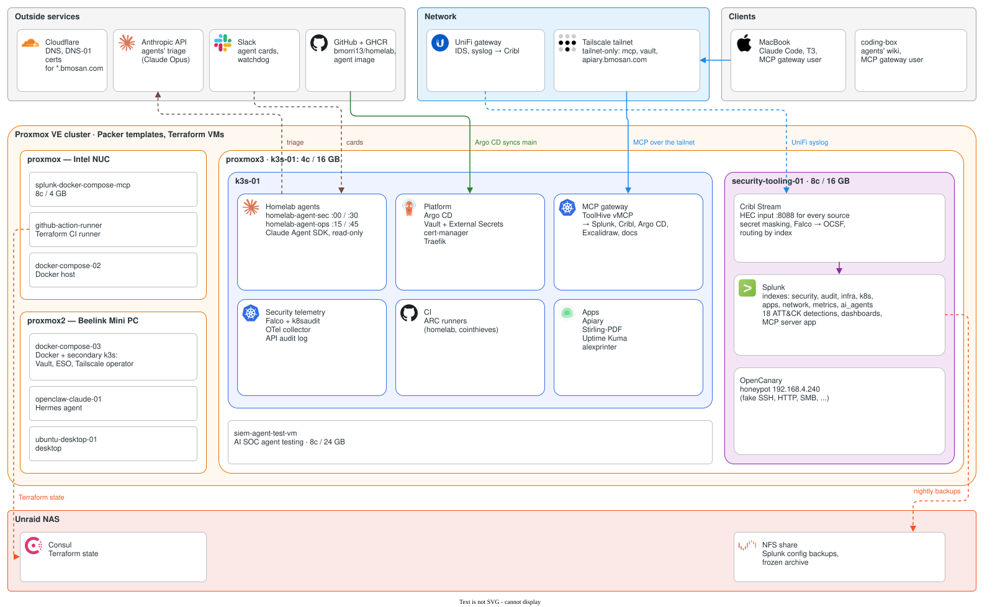

# homelab
- This repo contains the configurations and setup information for my homelab K3s clusters and Proxmox environment. Currently I am running an Intel NUC and [Beelink Mini PC](https://www.amazon.com/dp/B0DF7FFN22?ref=ppx_yo2ov_dt_b_fed_asin_title&th=1) running Proxmox.

## Clusters

| Cluster | Purpose | Key Components |
|---------|---------|----------------|
| Primary K3s (`k3s-01` VM on proxmox3) | Main workloads | ArgoCD, Vault, External Secrets, Cert Manager, Traefik, ARC runners, ToolHive MCP gateway, homelab agents, Falco, OTel collector |
| docker-compose-03-k3s (on proxmox2) | Secondary | Tailscale Operator, Vault, External Secrets |

## Architecture

More diagrams (deployment, data flow, the agents) are in [docs/architecture.md](docs/architecture.md).

## Prerequisites
- Setup a machine running Linux (e.g. an old laptop, Intel Nuc, cloud VM, etc.)
    - For me, I am running this on an Intel Nuc with ubuntu server installed
- Setup [K3s](https://docs.k3s.io/quick-start)
    - After setting this up I recommend getting your kube-config.yml file so that you can do inital deployments, port forwarding, etc. from your computer
    - Installing tooling such as [kubectl](https://kubernetes.io/docs/tasks/tools/#kubectl) and [helm](https://helm.sh/docs/intro/install/) on your local computer are also recommended
- Once you have those setup you should be ready to start deploying!

## Documentation

Setup guides, moved out of this README into [`docs/`](docs/README.md):

- [Architecture](docs/architecture.md)
- [Proxmox setup](docs/proxmox.md): repository fixes, HTTPS certs, VMs, Packer & Terraform
- Kubernetes (k3s-01):
  - [ArgoCD](docs/kubernetes/argocd.md)
  - [Vault](docs/kubernetes/vault.md)
  - [External Secrets Operator](docs/kubernetes/external-secrets.md)
  - [Cert Manager](docs/kubernetes/cert-manager.md)
  - [MetalLB](docs/kubernetes/metallb.md)
  - [Core infrastructure ingress](docs/kubernetes/ingress.md)
  - [GitHub Actions Runner Controller (ARC)](docs/kubernetes/arc.md)
- [Secondary K3s cluster (docker-compose-03-k3s)](docs/secondary-cluster.md)
- [Applications](docs/applications.md): Alex Printer tracker, Uptime Kuma, Stirling PDF
- [Monitoring](docs/monitoring.md)

## Component READMEs

Each of these lives next to its code:

| Component | README |
|---|---|
| Splunk logging box (Splunk, Cribl, detections, dashboards) | [monitoring_stack/splunk](infrastructure_tooling/monitoring_stack/splunk/README.md) |
| OTel host agent | [monitoring_stack/splunk/otel-agent](infrastructure_tooling/monitoring_stack/splunk/otel-agent/README.md) |
| OpenTelemetry Collector on k3s-01 | [otel_collector_k3s](infrastructure_tooling/otel_collector_k3s/README.md) |
| k3s API audit log | [k3s_audit](infrastructure_tooling/k3s_audit/README.md) |
| Falco | [monitoring_stack/falco](infrastructure_tooling/monitoring_stack/falco/README.md) |
| OpenCanary honeypot | [opencanary](infrastructure_tooling/opencanary/README.md) |
| ToolHive MCP gateway | [toolhive_mcp](infrastructure_tooling/toolhive_mcp/README.md) |
| Homelab agents | [homelab_agents](infrastructure_tooling/homelab_agents/README.md) |
| Apiary | [apiary](infrastructure_tooling/apiary/README.md) |
| Vault ingress | [vault_ingress](infrastructure_tooling/vault_ingress/README.md) |
| ESO cluster provider | [eso_cluster_provider_helm](infrastructure_tooling/eso_cluster_provider_helm/README.md) |
| Proxmox Packer & Terraform | [proxmox](infrastructure_tooling/proxmox/README.md) |
