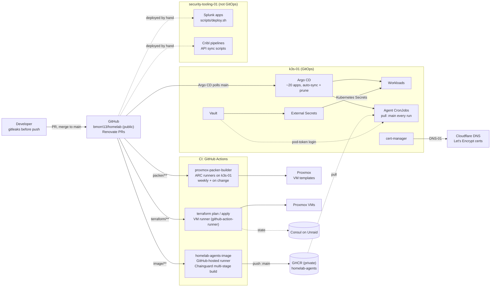
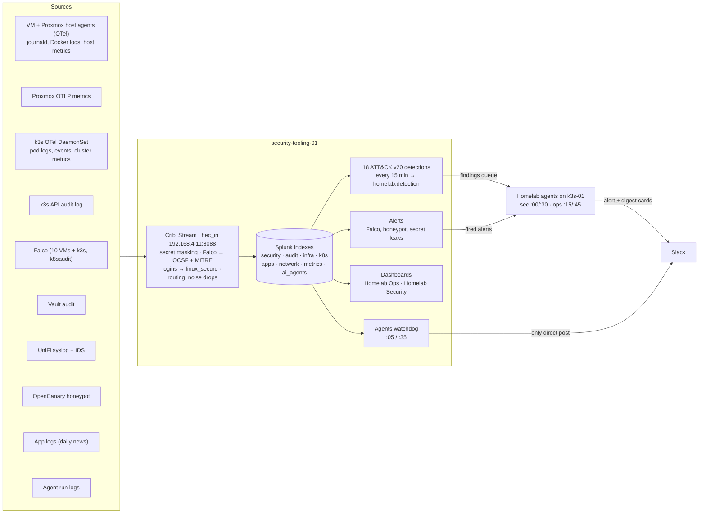

# Architecture

## Infrastructure
Proxmox nodes and their VMs, the k3s-01 cluster, the logging and security box, the network and outside services.

## How it's deployed
CI (GitHub-hosted, ARC and VM runners), Argo CD, and secrets from Vault through External Secrets. Splunk and Cribl on security-tooling-01 are deployed by hand, not by Argo CD.

## Data flow
Every source sends to Cribl's one HEC input; Cribl masks secrets, normalizes and routes to the Splunk indexes, and Splunk turns the data into detections, alerts and dashboards. The agents triage what the detections and alerts find.

## The agents
The run flow of the two triage agents and the watchdog that checks on them are in the [homelab agents README](../infrastructure_tooling/homelab_agents/README.md#how-a-run-works).

## Editing the diagrams
- **Infrastructure** is a draw.io diagram saved as `images/infrastructure.drawio.svg`: the SVG GitHub shows also contains the editable diagram. Open it in [draw.io Desktop](https://www.drawio.com/) (`brew install --cask drawio`) or the VS Code *Draw.io Integration* extension, edit, and save it under the same name. When exporting from the desktop app, use the light theme (`drawio -x -f svg --embed-diagram --theme light --embed-svg-fonts false --border 12 -o docs/images/infrastructure.drawio.svg <file>`); the default adaptive theme turns the background dark in GitHub's dark mode. Icons are from [homarr-labs/dashboard-icons](https://github.com/homarr-labs/dashboard-icons), embedded in the file.
- **Deployment, data flow and the agents** are Mermaid, written in the Markdown. GitHub draws them; edit the text in the same PR as the change they describe.
