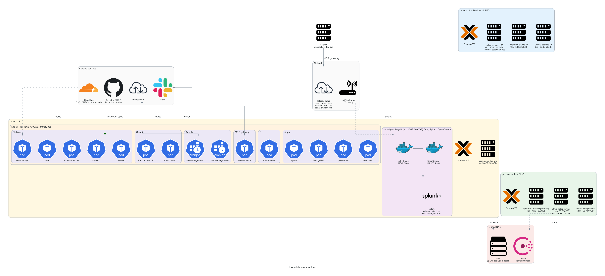
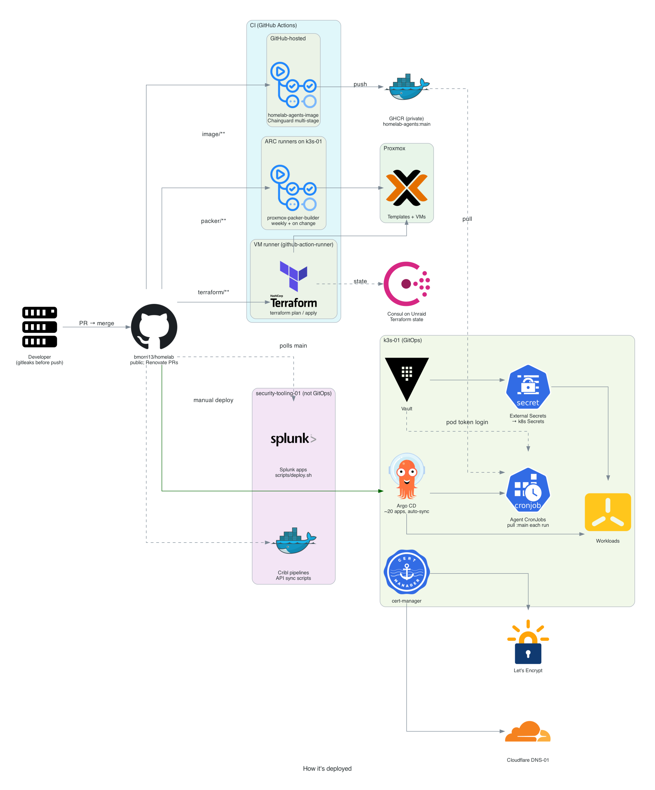
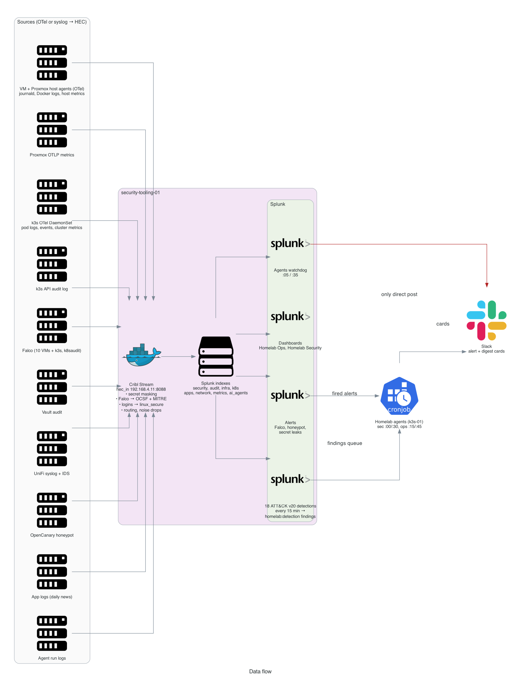

# Architecture

## Infrastructure
Proxmox nodes and their VMs, the k3s-01 cluster, the logging and security box, the network and outside services.



## How it's deployed
CI (GitHub-hosted, ARC and VM runners), Argo CD, and secrets from Vault through External Secrets.



## Data flow
Sources → Cribl → Splunk → detections, dashboards, the agents and Slack.



## The agents
The run flow of the two triage agents and the watchdog that checks on them are drawn (as Mermaid diagrams) in the [homelab agents README](../infrastructure_tooling/homelab_agents/README.md#how-a-run-works).

## Regenerating the diagrams
> Diagrams generated with [Python Diagrams](https://diagrams.mingrammer.com/).
> Regenerate:
> ```bash
> docker build -t homelab-diagrams docs/diagrams/
> docker run --rm -e OUTPUT_DIR=/output -v "$(pwd)/docs/images:/output" homelab-diagrams
> ```
