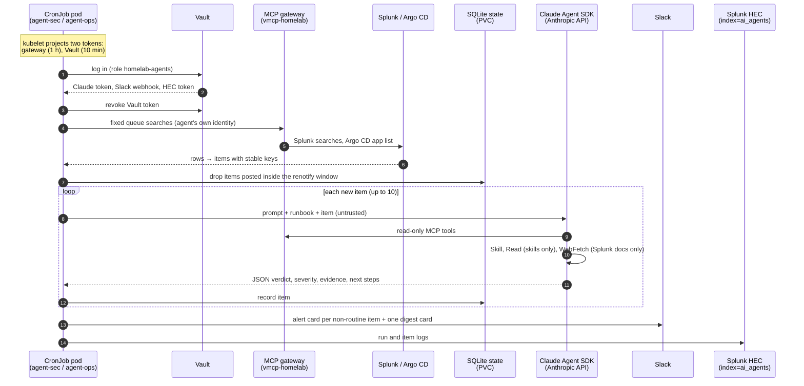
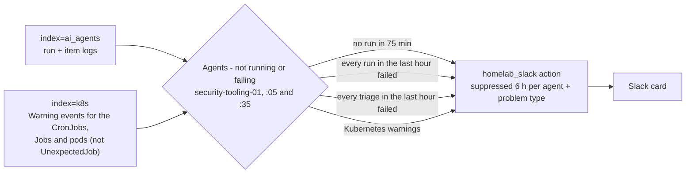

# Homelab agents

Two triage agents, run as Kubernetes CronJobs on k3s-01 every 30 minutes:

| Agent | CronJob (UTC) | Looks at | Gateway identity |
|---|---|---|---|
| Security (`sec`) | `homelab-agent-sec`, :00 and :30 | HL - detection findings (`index=security sourcetype=homelab:detection`) and the Falco, honeypot and secret-leak alerts that fired | `agent-sec`, 15 read-only tools |
| Operations (`ops`) | `homelab-agent-ops`, :15 and :45 | Capacity (filesystems, Proxmox storage, CPU, memory), Kubernetes workloads, pods and restarts, Docker restarts, Splunk scheduler skips/failures, Argo CD app health and sync | `agent-ops`, 23 read-only tools |

Results go to Slack as Block Kit cards, and every run and item is logged to Splunk `index=ai_agents sourcetype=homelab:agent`.

## Layout

| Path | What |
|---|---|
| `image/` | The container: `app/` (runner, queues, state, prompts, runbooks), `requirements.txt` (hash-locked, from `requirements.in` with `uv pip compile --generate-hashes`), `select_skills.py`, `Dockerfile`. Layered build on Chainguard images, both pinned by digest: `python:latest-dev` builds the virtualenv (wheels only, hashes checked) and selects the skills; the runtime is `python:latest` (no shell, no package manager, no pip, nonroot UID 65532) with only the venv, the app and the skills, all owned by root |
| `Chart.yaml`, `values.yaml`, `templates/` | Helm chart: the two CronJobs, the state volume, the NetworkPolicy, the GHCR pull secret |
| `application.yaml` | Argo CD Application (applied once by hand) |
| `.github/workflows/homelab-agents-image.yml` | Builds the image on GitHub-hosted runners and pushes `ghcr.io/bmorri13/homelab-agents` (`:main` from main, `:<branch>` from branches, `:sha-<commit>` always) |

## How a run works

`image/app/runner.py` is deterministic; the model only triages.



1. **Credentials.** The pod runs as the agent's own ServiceAccount (`agent-sec` or `agent-ops`, in `toolhive-clients`, created by the `toolhive_mcp` chart) with no Kubernetes API token. The kubelet projects two tokens into it, bound to the pod and rotated automatically:
   - audience `https://mcp.bmosan.com`, 1 hour: the gateway token;
   - audience `vault`, 10 minutes: logs in to Vault (role `homelab-agents`), reads the Slack webhook, the Cribl HEC token and the Claude subscription token, and revokes the Vault token.

   Nothing long-lived is stored anywhere: no token file, and no Kubernetes Secret with the Claude, Slack or HEC values (they stay in Vault and in the run's memory). The only Kubernetes Secret is the GHCR pull credential.
2. **Queue.** `app/queues.py` runs fixed Splunk searches (and the Argo CD application list) through the gateway as the agent's own identity, over the last 2 hours. Each row becomes an item with a stable key: the detection plus host/user/source/object, or an alert's own suppression fields (alerts are read back with `| loadjob` from `_audit action=alert_fired`).
3. **Dedupe.** `app/state.py` (SQLite on the `homelab-agents-state` volume) skips items already posted inside the renotify window (24 h security, 12 h ops). An item triaged but not posted (Slack down or unset) is posted on the next run without re-triaging.
4. **Triage.** For each new item, up to 10 per run, the Claude Agent SDK runs `claude-opus-5-5` (effort medium, 40 turns max) with:
   - the gateway as MCP server `homelab` (`allowed_tools=mcp__homelab__*`): what each agent can call is enforced by the gateway's Cedar allowlist and the Splunk `mcp_agent` role, not by the prompt;
   - built-in tools limited to `Skill`, `Read` and `WebFetch` (no shell, no writes) with `permission_mode=dontAsk` (anything not allowed is denied, never asked). `Read` works only inside the agent's working directory, which holds nothing but the skills; `WebFetch` is allowed only for Splunk documentation sites (`config.DOC_DOMAINS`);
   - the **Splunk agent skills** (below), the agent's system prompt (`app/prompts/<agent>.md`) and the item's runbook (`app/runbooks/`), with the item's data marked as untrusted;
   - a JSON schema for the result: verdict, confidence, severity, headline, summary, evidence, next steps.
5. **Report.** Every new item is posted, whatever the verdict, as Slack Block Kit cards:
   - one **alert card** per item the agent doesn't call routine (or couldn't triage), most severe first: header with severity, title and the agent's one-line headline, a field grid (severity, verdict and confidence, host, and up to three facts such as source, user or object), *Recommended Action*, and **View Dashboard** / **View Analysis** links (plain links, not Block Kit buttons, which need an interactive Slack app; the analysis link opens that item's full triage in Splunk);
   - one **digest card** per run for everything routine (one line each, repeats collapsed) and anything over the per-run limit.

   Severity uses one scheme everywhere: red critical, orange high, yellow warning (medium), blue info (low). Text from logs or the model is escaped, so it can't add mentions or links. If a run fails, a card says so.

## Splunk agent skills

The image bakes in a selection of [Splunk's agent skills](https://github.com/splunk/splunk-agent-skills) (Apache-2.0), pinned to one commit (`SKILLS_COMMIT` in the Dockerfile), at `/app/workspace/.claude/skills`. `select_skills.py`:
- copies only the advisory and diagnostic skills that work from read-only evidence and that some agent uses (9: scheduled-search performance and troubleshooting, search performance, ingestion and HEC, Splunk health, indexes and storage, field extraction and CIM, alerting);
- drops scripts and other non-Markdown files;
- strips each skill's `allowed-tools` frontmatter, so no skill can pre-approve a tool.

Skills that need a shell or write files (`splunk-search` via `splunkctl`, the visualization and setup-page builders, Splunk Cloud admin) are left out. Each agent gets its own list (`config.AGENTS[...]["skills"]`).

Each list is short on purpose: every skill's description is in the model's context on every turn, and similar descriptions compete. The security agent has 3 (is the finding itself right: search logic, fields, alert throttling); the ops agent has 7 (Splunk scheduler, ingestion, HEC, health, storage). The model decides when to invoke one, so the prompts say which skill fits which kind of item and the runbooks name the skill where one applies (`splunk-health.md`, `telemetry.md`, `capacity.md`, `general.md`, `secret-leak.md`).

Whether they are used shows in Splunk: each item's `tools_used` has a `Skill:<name>` count, and the *Skills used by the agents* panel on *Homelab Operations* charts it. To add a skill: add it to `SKILLS` in `select_skills.py` and to the agent's list, say in the prompt when it fits, and name it in the runbooks it belongs to.

To update the skills: change `SKILLS_COMMIT`, read the diff of the skills you ship (they become part of the agents' instructions), and push.

## Deploy

```bash
kubectl apply -f infrastructure_tooling/homelab_agents/application.yaml
```

Image changes deploy themselves: CronJob pods are new every run and pull `:main` (`imagePullPolicy: Always`), so the run after the workflow finishes uses the new image. Chart changes go through Argo CD as usual. To stop both agents, set `suspend: true` in `values.yaml`.

### Secrets in Vault (once)

| Path | Key | What |
|---|---|---|
| `kv/homelab-agents` | `claude_oauth_token` | Subscription token from `claude setup-token` (valid one year) |
| `kv/slack-alerts` | `webhook_url` | Slack incoming webhook |
| `kv/cribl-hec` | `token` | Already there (OTel collector on k3s) |
| `kv/apiary-ghcr-pull` | `username`, `token` | GHCR `read:packages` credential, shared with Apiary |

Store them without the value touching shell history or a terminal echo, for example:

```bash
claude setup-token   # on any machine with Claude Code; copy the whole token (108 chars; it may wrap)
ssh -t root@k3s-01 'read -rsp "Claude token: " T; echo
  case "$T" in sk-ant-oat01-*) ;; *) echo "wrong prefix, not saved"; exit 1;; esac
  [ ${#T} -ge 100 ] || { echo "only ${#T} chars, looks truncated, not saved"; exit 1; }
  { kubectl -n default get secret vault-token -o jsonpath={.data.token} | base64 -d; echo; printf %s "$T"; } |
  kubectl -n vault exec -i vault-0 -- sh -c "read -r VAULT_TOKEN; export VAULT_TOKEN; vault kv put kv/homelab-agents claude_oauth_token=-"'

ssh -t root@k3s-01 'read -rsp "Slack webhook URL: " T; echo
  { kubectl -n default get secret vault-token -o jsonpath={.data.token} | base64 -d; echo; printf %s "$T"; } |
  kubectl -n vault exec -i vault-0 -- sh -c "read -r VAULT_TOKEN; export VAULT_TOKEN; vault kv put kv/slack-alerts webhook_url=-"'
```

(The Vault UI works too: `https://vault.bmosan.com/ui` from the tailnet, KV v2 engine `kv`.) A new value is picked up on the next run.

The Vault side (runtime, not GitOps; already applied):

```bash
vault policy write homelab-agents-read - <<'EOF'
path "kv/data/slack-alerts"   { capabilities = ["read"] }
path "kv/data/cribl-hec"      { capabilities = ["read"] }
path "kv/data/homelab-agents" { capabilities = ["read"] }
EOF
vault write auth/kubernetes/role/homelab-agents \
  bound_service_account_names=agent-sec,agent-ops bound_service_account_namespaces=toolhive-clients \
  audience=vault token_policies=homelab-agents-read token_ttl=10m token_max_ttl=15m
```

### Network

The pods accept no connections. They can reach:
- DNS;
- the vMCP Service (`vmcp-homelab.toolhive-mcp:4483`), which admits them through the gateway's `allow-agents` NetworkPolicy;
- Vault (`vault.vault:8200`);
- Splunk HEC (`192.168.4.11:8088`);
- HTTPS on the public internet (Anthropic API, Slack, Splunk docs), with private ranges excluded.

Claude Code's telemetry and update checks are off (`CLAUDE_CODE_DISABLE_NONESSENTIAL_TRAFFIC`).

## Operating it

```bash
kubectl -n toolhive-clients get cronjobs,jobs,pods -l app.kubernetes.io/name=homelab-agents
kubectl -n toolhive-clients logs job/<job>                                        # one run's summary line
kubectl -n toolhive-clients create job --from=cronjob/homelab-agent-ops ops-now   # run now
```

To look at a queue without triaging or posting, run a one-off job with `--collect-only`. Use `--dry-run` instead to triage and print the Slack cards without posting:

```bash
kubectl -n toolhive-clients create job --from=cronjob/homelab-agent-sec sec-look --dry-run=client -o json |
  jq '.spec.template.spec.containers[0].args += ["--collect-only"]' | kubectl create -f -
```

In Splunk: `index=ai_agents sourcetype=homelab:agent kind=run | table _time source status collected new triaged cost_usd error`. Cost is the API-equivalent figure the SDK reports; on the subscription it counts against usage limits, not a bill. Pod logs are also in `index=k8s` (namespace `toolhive-clients`).

**Watchdog.** A run that never starts can't report itself, so Splunk watches instead. *Agents - not running or failing* (app `85_homelab_ops`, at :05 and :35) posts a card to Slack through the `homelab_slack` action when an agent:
- hasn't run for 75 minutes;
- had every run in the last hour fail;
- had every triage in the last hour fail (this is how an expired Claude token shows up);
- got Kubernetes warnings for its CronJob, Jobs or pods (failed job, image pull, scheduling, deadline).



It's suppressed per agent and problem type for 6 hours. Splunk runs on security-tooling-01, so it still fires if k3s-01 is down. The webhook it uses is a copy of the Vault one in Splunk's credential store; after changing `kv/slack-alerts`, refresh it:

```bash
ssh root@k3s-01 'kubectl -n default get secret vault-token -o jsonpath={.data.token} | base64 -d |
  kubectl -n vault exec -i vault-0 -- sh -c "read -r VAULT_TOKEN; export VAULT_TOKEN; vault kv get -field=webhook_url kv/slack-alerts"' |
  ssh root@security-tooling-01 /opt/splunk-stack/scripts/set-slack-webhook.sh
```

**Dashboards.** *Homelab Security* has a **Security agent** section (runs, failures, items triaged, items not routine, cost, verdicts, the triaged items and the run log). *Homelab Operations* has an **Agents** section with the health of both agents and the ops agent's items.

**Changing what they look at.** To add an ops check, add a row to `OPS_CHECKS` in `image/app/queues.py`; to change what the security agent reads, edit `security()` there. Runbooks are plain Markdown, matched by detection or alert name.
