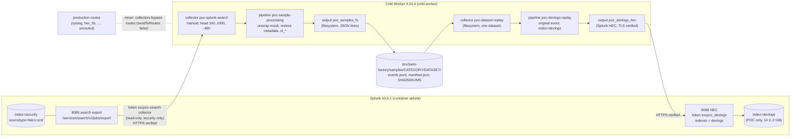

# siem-software-factory: Splunk Search Collector POC

Pull real events out of the homelab Splunk with Cribl Stream's **Splunk Search Collector**, keep each original event byte-for-byte with its Splunk metadata, save it as a reusable dataset, and replay that dataset into a dev index. The datasets are meant to be the fixtures that coding agents build and test Cribl pipelines, Splunk configs and detections against.

Status (2026-11-08): working end to end on `security-tooling-01`. All 24 automated checks pass at 100 and at 1,000 events (see [Results](#results)).

## What already existed

Everything runs on the existing stack. No new Splunk or Cribl instance was deployed.

| Component | Where | Version |
|---|---|---|
| Splunk Enterprise (standalone: indexer, search head, license manager) | container `splunk` on `security-tooling-01` (192.168.4.11), [`docker-compose.yml`](../docker-compose.yml) | 10.6.1.1, Developer license |
| Cribl Stream Leader | container `cribl`, network `cribl-leader` 192.168.237.2 | 4.20.4 |
| Cribl Stream Worker (group `default`, 1 Worker) | container `cribl-worker`, networks `default` (with Splunk) and `cribl-leader` | 4.20.4 |

- **Splunk management API, 8089**: published on 192.168.4.11 only. `scripts/mgmt-firewall.sh` lets only k3s-01 and this host's Docker bridges reach it. Its cert is from the homelab CA, with SANs `splunk-homelab, security-tooling-01, localhost, 192.168.4.11, 127.0.0.1`.
- **Splunk HEC, 8088**: enabled with SSL and the same cert, but not published. It's reachable only on the compose network, as `splunk-homelab:8088`. Before this POC it had no tokens; everything reaches Splunk from Cribl over S2S 9997.
- **Cribl**: the Leader API is HTTPS on 9000 (firewalled to k3s-01 and the host). The Worker was healthy, and the group config was clean (no uncommitted changes).
- **Indexes with data in the last 48h**: `security` (falco:ocsf 11,516, trivy:* about 2,100, homelab:detection 44), `network`, `infra`, `k8s`, `audit`, `apps`, `ai_agents`, `metrics`. There was no dev Splunk instance and no test index.
- **Source chosen**: `index=security sourcetype=falco:ocsf`, Falco runtime-security findings as OCSF JSON. It's the security index, has plenty of volume, and its events are single-line JSON. No index-time transforms apply to it (`btool props list falco:ocsf`), so replaying it can't re-route events.
- **Who can read a new index**: the only Splunk users are `admin`, `bmo` (admin), `mcp-agent` and `mcp-gateway`, and all of them can already read `security`. Copying `security` events into `devlogs` exposes them to nobody new.

### Issues found, and what was done

| Issue | Effect | Resolution |
|---|---|---|
| The Splunk Search collector has no CA option, and `rejectUnauthorized` defaults to **false** | TLS would go unverified | The Worker now trusts the homelab CA (`NODE_EXTRA_CA_CERTS=/opt/cribl/tls/ca.crt`; `tls-certs.sh` copies the CA there). Collector and HEC destination both set `rejectUnauthorized: true`. Test A7 proves a wrong-name cert is refused. |
| The Worker reaches Splunk as `splunk`, which is not in the cert | Hostname check would fail | 8089: `https://192.168.4.11:8089` (in the cert; the firewall allows Docker bridges). HEC: `splunk-homelab:8088` (Docker DNS resolves the container hostname). |
| Cribl rejects dot-less host names in the collector ("splunk-homelab is not a valid IPv4, IPv6, or FQDN") | `https://splunk-homelab:8089` refused | Use the IP for the search head, as above. The HEC destination accepts `splunk-homelab`. |
| The shipped *Splunk Search Ruleset*'s json rule (`__outputMode === "json"`) did not match on 4.20.4: events showed `cribl_breaker: fallback` | Each event's `_raw` was the export API's wrapper `{"preview":false,"offset":N,"result":{...}}`, and `host`/`source` were the Worker and the URL | Dedicated breaker `poc-splunk-search-json` (one event per export line). The pipeline unwraps `result` and restores the original fields. Tests A6/B4 check that no wrapper survives. |
| A job started right after a config deploy failed with `WorkerProcessLostError` | One failed capture | `setup.py` waits for the Worker to load the new config and settle. Jobs retry once on exactly that error. |
| The Worker had no persistent, host-visible place for files | Samples would live in the container's config volume | New bind mount `/srv/siem-factory` → `/opt/cribl/siem-factory` (root-only, created by `deploy.sh`). |

The two compose changes (CA env, mount) needed one Worker recreate. It took 11 s, and ingestion into every index showed no gap across it.

## Architecture



1. **Capture**: `collect.py` runs `poc-splunk-search` ad hoc with a run id. The Worker exports a bounded search over verified TLS with the read-only token. `poc-sample-processing` turns each export line back into the original event, and `poc_samples_fs` writes JSON lines to `/srv/siem-factory/incoming/<run_id>/`.
2. **Library**: `collect.py` validates every record (schema, sha256 of `_raw`, metadata consistency, loop guard), drops duplicates by Splunk event id, sorts by event time, and writes the dataset plus manifest and checksums.
3. **Replay**: `replay.py` runs `poc-dataset-replay` over that one dataset's `events.jsonl`. `poc-devlogs-replay` restores the original `_raw`, `_time`, host, source and sourcetype, sets `index=devlogs`, and `poc_devlogs_hec` posts to HEC.
4. **Validate**: `run_tests.py` compares source Splunk, dataset and `devlogs` event by event.

### Isolation from production

- Both collectors have `sendToRoutes: false` with their own pipeline and output, so nothing they produce enters the route table. No route references a POC object, and the group's default output is still `splunk` (test A2).
- Scheduling is disabled on both. The replay collector's saved path is a placeholder that matches nothing, so a bare UI run replays nothing.
- **No collection loop**, guarded three ways. The collector's Splunk role disallows `devlogs`; test A8 has it search `devlogs` after a replay and gets 0 results. The capture pipeline drops anything whose index is `devlogs`. And the dataset validator rejects records captured from it.
- The HEC token can write only `devlogs` (`index = indexes = devlogs`). Test C6 sends an event for another existing index (`unrouted`) and gets `400 Incorrect index (code 7)`.
- **Bounded searches only**: inline `earliest=-48h latest=now`, the collector's own earliest/latest, `| head N` with N ≤ 1000 (enforced by `collect.py`), 120 s request timeout and 10 min job timeout. The role caps every search at 72 h back and 72 h wide (`srchTimeWin`/`srchTimeEarliest` = 259200), 2 concurrent searches, 300 s each, no real-time searches.

## Configuration

All POC objects carry `poc`/`sscpoc` in their names. The definitions are in this directory and are applied through the Splunk and Cribl REST APIs by [`scripts/setup.py`](scripts/setup.py), which is idempotent: a second run reports "everything already in place".

### Cribl (Worker Group `default`)

| Object | File | Key settings |
|---|---|---|
| Collector `poc-splunk-search` | [cribl/collectors/poc-splunk-search.json](cribl/collectors/poc-splunk-search.json) | `searchHead https://192.168.4.11:8089`, `endpoint /services/search/v2/jobs/export`, `outputMode json`, extra param `time_format=%s.%6N` (exact epoch subseconds), `earliest -48h`, `latest now`, auth `tokenSecret` → `poc_splunk_search_token`, `rejectUnauthorized true`, `timeout 120`, retries on 429/503, schedule disabled, job timeout 10m, breaker `poc-splunk-search-json`, pipeline `poc-sample-processing`, output `poc_samples_fs`, `sendToRoutes false` |
| Search | same | `search index=security sourcetype="falco:ocsf" earliest=-48h latest=now \| head 100 \| fields _raw _time _indextime _cd _bkt host source sourcetype index splunk_server` (`collect.py --max` rewrites only the head count, up to 1000) |
| Breaker `poc-splunk-search-json` | [cribl/breakers/](cribl/breakers/poc-splunk-search-json.json) | one event per export line, 1 MB max event, time from the pipeline |
| Pipeline `poc-sample-processing` | [cribl/pipelines/](cribl/pipelines/poc-sample-processing.json) | see [Sample processing](#sample-processing) |
| Output `poc_samples_fs` | [cribl/outputs/](cribl/outputs/poc_samples_fs.json) | filesystem, `/opt/cribl/siem-factory/incoming/<sf_run_id>/`, JSON, uncompressed, staging on the same mount, files closed after 5 s idle |
| Collector `poc-dataset-replay` | [cribl/collectors/](cribl/collectors/poc-dataset-replay.json) | filesystem, path set per run to one dataset, filter `source.endsWith('/events.jsonl')`, breaker `poc-dataset-jsonl`, pipeline `poc-devlogs-replay`, output `poc_devlogs_hec`, `sendToRoutes false` |
| Pipeline `poc-devlogs-replay` | [cribl/pipelines/](cribl/pipelines/poc-devlogs-replay.json) | restores the original event; `index = 'devlogs'`; sends the `sf_*` correlation fields as indexed fields |
| Output `poc_devlogs_hec` | [cribl/outputs/](cribl/outputs/poc_devlogs_hec.json) | Splunk HEC `https://splunk-homelab:8088/services/collector/event`, auth from secret `poc_devlogs_hec_token`, `rejectUnauthorized true`, concurrency 2 |
| Secrets `poc_splunk_search_token`, `poc_devlogs_hec_token` | (created by `setup.py`) | Cribl-encrypted text secrets; never in git or output |

### Splunk (all inside app `siem_factory_poc`, so no repo-managed app or `system/local` file changes)

| Object | Settings |
|---|---|
| Index `devlogs` | `volume:local/devlogs`, 14-day retention, 2 GB cap |
| Role `sscpoc_search_collector` | capability `search` only (the `[default]` stanza's `run_collect`, `run_mcollect`, `edit_own_objects` and `schedule_rtsearch` are switched off; `list_all_objects` is inherited). `srchIndexesAllowed = security`, `srchIndexesDisallowed = devlogs`, 72 h window, 2 jobs, 300 s, no real-time |
| Role `sscpoc_validator` | same, plus read on `devlogs`, 30-day window (used only by the tests) |
| Users `sscpoc-search-collector`, `sscpoc-validator` | one role each; random passwords that are never stored; they authenticate with tokens only |
| Tokens | 30 days, renewed by `setup.py` within 7 days of expiry or with `make rotate`, which also deletes the user's older tokens. Collector token goes to the Cribl secret; validator token to `/root/.siem-factory/validator.token` (0600) |
| HEC token `sscpoc_devlogs` | `index = devlogs`, `indexes = devlogs`, no ACK |

### Changes outside this directory

- [`docker-compose.yml`](../docker-compose.yml) (Worker only): `NODE_EXTRA_CA_CERTS=/opt/cribl/tls/ca.crt`, and the volume `${SIEM_FACTORY_DATA_DIR:-/srv/siem-factory}:/opt/cribl/siem-factory`.
- [`scripts/tls-certs.sh`](../scripts/tls-certs.sh): copies the CA to `/srv/cribl-worker-tls/ca.crt` (prints `changed: cribl-worker`, so `deploy.sh` restarts the Worker when it changes).
- [`scripts/deploy.sh`](../scripts/deploy.sh): creates `/srv/siem-factory` with mode 0700.

## Sample processing

`poc-sample-processing` gets one Splunk export line per event: `{"preview":false,"offset":N,"result":{"_raw":...,"_time":...,"host":...}}`. Its code function:

1. Parses the line. Lines without a `result` (Splunk's `messages`/`lastrow` control lines), preview rows, and anything from `devlogs` are marked and dropped.
2. Sets `_raw` to `result._raw`, the original event, byte-for-byte; the wrapper never reaches the output.
3. Sets `_time` to the original event time from `result._time` (epoch with microseconds through `time_format`, with a fallback parser for Splunk's default format), and `host`, `source`, `sourcetype`, `index` to the original values.
4. Adds collection metadata: `sf_collector_id`, `sf_run_id` (from job metadata), `sf_collected_at`, `sf_splunk_event_id` (`<splunk_server>/<_bkt>/<_cd>`, unique per stored event), `sf_splunk_indextime`, `sf_result_offset`, `sf_raw_sha256`, and `sf_orig_*` copies of the four metadata fields.
5. Keeps only `_raw`, `_time`, `host`, `source`, `sourcetype`, `index`, `sf_*`.

### Event time on replay

- The dataset keeps three times apart: `_time` (when the event happened, from the source Splunk), `sf_splunk_indextime` (when the source indexed it), and `sf_collected_at` (when Cribl collected it).
- `poc-devlogs-replay` sends `_time` unchanged. Cribl's HEC destination posts it as the event's `time` to `/services/collector/event`, and Splunk uses that value as-is: no timestamp extraction runs on that endpoint, so `TIME_FORMAT`/`MAX_DAYS_AGO` in `props.conf` don't apply.
- `_indextime` in `devlogs` is the replay time. Test C4 checks both: `_time` equals the original on every event (within 0.5 ms), and `_indextime` falls after the replay started.
- `sourcetype` is never changed, so search-time `props` for it (here `KV_MODE=json` from `85_ocsf`) apply exactly as in production. Runs are told apart by the indexed field `sf_replay_id`, not by inventing a sourcetype.
- `devlogs` keeps data for 14 days, measured from event time. A dataset older than that can still be replayed, but Splunk freezes it almost immediately. Raise `frozenTimePeriodInSecs` for long-lived fixtures.

Metadata in `devlogs`: `host`, `source` and `sourcetype` are the originals. `index` is `devlogs`, with the original kept in `sf_orig_index`. These indexed fields are added: `sf_dataset_id`, `sf_seq`, `sf_run_id`, `sf_replay_id`, `sf_splunk_event_id`, `sf_raw_sha256`. Search them with `::`, for example `index=devlogs sf_replay_id::<id>`, or `| tstats count where index=devlogs by sf_replay_id`.

## Sample library

```text
siem-software-factory/              (this directory, in git)
├── Makefile
├── config/poc.json                 non-secret settings: source, limits, names, paths
├── cribl/{collectors,pipelines,outputs,breakers}/   Cribl definitions (applied by setup.py)
├── samples/{cloudtrail,firewall,generic,falco}/     local copies (make pull); git-ignored
├── scripts/                        setup, check, collect, replay, run_tests, cleanup
├── tests/test_offline.py           offline unit tests (no services; CI-safe)
└── reports/                        test reports (git-ignored)

/srv/siem-factory/                  (on security-tooling-01, root only, survives container recreation)
├── samples/<category>/<dataset_id>/
│   ├── events.jsonl                one record per event, sorted by event time
│   ├── manifest.json
│   └── SHA256SUMS                  `sha256sum -c SHA256SUMS`
├── incoming/<run_id>/              Cribl's raw output, removed once the dataset is built
└── .staging/                       Cribl's open files
```

A record (`siem-factory.event/v1`; `_raw` shortened):

```json
{"_raw":"{\"class_uid\":2004,\"class_name\":\"Detection Finding\",...}","_time":1794109056.04,
 "host":"k3s-01","source":"k3s-01","sourcetype":"falco:ocsf","index":"security",
 "sf_orig_host":"k3s-01","sf_orig_source":"k3s-01","sf_orig_sourcetype":"falco:ocsf","sf_orig_index":"security",
 "sf_splunk_event_id":"splunk-homelab/security~29~<bucket guid>/29:1901938","sf_splunk_indextime":1794109060,
 "sf_raw_sha256":"ea1d5416...","sf_raw_bytes":2232,
 "sf_collector_id":"poc-splunk-search","sf_run_id":"falco-20261108T041204Z-14a9f4",
 "sf_dataset_id":"falco-20261108T041204Z-14a9f4","sf_collected_at":"2026-11-08T04:12:04.562Z",
 "sf_result_offset":0,"sf_seq":0,"sf_schema":"siem-factory.event/v1"}
```

`manifest.json` (`siem-factory.dataset/v1`) records:

- dataset id, category, creation time, event count, duplicates dropped, invalid lines
- the capture: collector, run id, Cribl job id and state, the exact SPL, window, max, whether the result hit the max, first/last collection time
- the source: Splunk API, counts by index, sourcetype and host
- the event-time range, the hash, size and line count of `events.jsonl`, the storage backend and URI, and how to replay

It also carries a handling note: real data, not sanitized.

The top-level `host`/`source`/`sourcetype`/`index` make a record readable as-is by Cribl and HEC tooling. The `sf_orig_*` copies are the provenance a reader can't overwrite.

**Moving to S3 or MinIO**: everything goes through `dataset.LocalStore` (`put_bytes`/`get_bytes`/`exists`/`list` over keys `<category>/<dataset_id>/<file>`). An S3 backend implements the same four methods over a bucket prefix. On the Cribl side, `poc_samples_fs` becomes an S3 destination with the same partition expression, and the replay collector becomes an S3 collector over the same key. The manifest's `storage.uri` then reads `s3://...`. This host already runs a SeaweedFS S3 endpoint (`s3search`, 127.0.0.1:8333) that could serve as a lab target.

**Git**: `samples/**` and `reports/**` are ignored, so only the empty category directories are tracked. The datasets are real security telemetry; copy them only to private storage (`make pull` puts one under `samples/` locally, still ignored). Sanitized fixtures, once reviewed, belong in a separate `fixtures/` directory.

## Usage

On `security-tooling-01` as root, in `/opt/splunk-stack/siem-software-factory`. `deploy.sh` ships it with the rest of the stack; `make push` copies it ahead of a deploy. From a workstation, prefix any target with `remote-`, for example `make remote-test MAX=1000`.

```sh
make prereq            # Splunk/Cribl up, Worker->Splunk TLS on 8089 and 8088, mount, source data
make plan              # what setup would create or change
make setup             # create/update everything (idempotent)
make check             # prereq + POC config valid + tokens + secrets
make collect           # one capture, head 100        -> prints the manifest
make collect MAX=1000  # up to 1000
make replay            # newest dataset -> devlogs    (or DATASET=<id>)
make test              # capture 100 + replay + tests A-D -> reports/<test run id>/report.{json,md}
make test-1000
make report            # newest report
make unit              # offline tests
make rotate            # new Splunk tokens
make clean             # show what cleanup would remove; CONFIRM=yes to do it
```

**Manual collection from the Cribl UI**: open *Data → Sources → Collectors → Splunk Search → poc-splunk-search → Run*. Leave *Send to routes* off. The events land in `/srv/siem-factory/incoming/manual/` (no run id is passed); `make collect` does the same and builds the dataset. Prefer `make collect`.

**Replaying a saved dataset**: run `make replay DATASET=<id>`. Each replay gets its own `sf_replay_id`, so replaying the same dataset twice gives two separable copies (test D3 lists them). To remove replayed copies, let `devlogs` age out, or run `make clean CONFIRM=yes`, which deletes the index.

## Validation

`make test` runs one capture and one replay under a single test run id. That id is the replay id, and the capture run and dataset id are `<category>-<same suffix>`. One id finds the report, the dataset, and the events (`index=devlogs sf_replay_id::<test run id>`).

| Test | What it proves |
|---|---|
| A1 | collector config: export endpoint, JSON, schedule off, TLS verified, token from secret, timeouts, bounded search, dedicated breaker/pipeline/output, routes bypassed |
| A2 | no route uses a POC pipeline/output; default output unchanged |
| A3 | the Splunk account is least privilege (role, capabilities, indexes, time window) |
| A4 | the job authenticated and ran, with no failed tasks |
| A5 | it returned real events: exactly `min(max, available in window)` |
| A6 | breaking: one export result per event (distinct event ids, offsets 0..N-1 exactly once, no wrapper left) |
| A7 | TLS verification is enforced: the same Splunk at an address not in its cert is refused |
| A8 | the collector account gets 0 results from `devlogs`, after a replay has put data there |
| B1–B6 | dataset files and checksums; valid JSONL with every field; host/source/sourcetype/index/_time equal to the source Splunk now; raw events rebuilt byte-for-byte (sha256 equal to Splunk's own `sha256(_raw)`); manifest consistent; stored on a host bind mount |
| C1–C6 | the replay job read every record; all events in `devlogs`; original host/source/sourcetype; `_time` original and `_indextime` = replay; raw hashes equal; HEC token rejected for any other index |
| D1–D4 | counts source = dataset = devlogs; sha256 multisets equal in all three; no duplicates in a run, repeated replays counted per replay id; event time < collection time, and index time ≥ event time |

Reports contain ids, counts, hashes of `_raw` and error text, scrubbed of every secret the process knows. They never contain event content.

## Results

All runs on 2026-11-08 against live data. These are real captured events; no synthetic events were needed (11,516 were available in the window).

| Test run | Events | Result | Notes |
|---|---|---|---|
| `sftest-20261108T040747Z-0b4cb2` | 100 | 23/24 | A8 false failure: Cribl counts Splunk's `lastrow` message line as a collected event. Splunk had returned 0 results. A8 now inspects the returned lines. |
| `sftest-20261108T041204Z-14a9f4` | 100 | **24/24 PASS** | after a full `make clean CONFIRM=yes` and a rebuild from nothing with `make setup` |
| `sftest-20261108T041247Z-8e683b` | 1,000 | **24/24 PASS** | 1,000 source = 1,000 dataset = 1,000 devlogs; events 00:46:14 to 03:37:36 UTC; 3.18 MB `events.jsonl`, 2.23 MB raw; 43 s end to end |
| `sftest-20261108T041340Z-e4f99b` | 100 (existing dataset `…14a9f4`) | **24/24 PASS** | second replay of the same dataset: D3 shows two copies of 100, one per replay id |

Also verified:
- `make check`: 12/12. `make unit`: 12 offline tests pass.
- `setup.py` run twice in a row reports no changes. Cleanup then setup rebuilds everything (18 objects) and the suite passes.
- No POC event in any index but `devlogs`: a search over all indexes for the probe sourcetype, the probe text and `sf_replay_id` found only the journald record of the search command itself.
- Resource use while replaying 1,000 events: Worker about 22% CPU, 678 MiB of its 2 GiB limit.

## Troubleshooting

| Symptom | Cause / fix |
|---|---|
| Task error `... is not a valid IPv4, IPv6, or FQDN` | Cribl refuses dot-less host names in the collector: use `https://192.168.4.11:8089` |
| Task error `Hostname/IP does not match certificate's altnames` or `self-signed certificate in certificate chain` | Wrong address, or the Worker lacks the CA. Run `make prereq`, which checks `NODE_EXTRA_CA_CERTS` and the Worker → 8089/8088 TLS paths |
| `WorkerProcessLostError` | The job started while the Worker reloaded config after a deploy; it is retried once. Re-run. |
| Collector returns 0 events | The source has nothing in the window (`make prereq` counts it), or the role doesn't allow that index (`srchIndexesAllowed`) |
| `_raw` looks like `{"preview":false,...}` downstream | The event bypassed `poc-sample-processing`, or a different breaker was used |
| HEC 400 `Incorrect index` (code 7) | The token allows only `devlogs`; `poc-devlogs-replay` must set `index` |
| HEC 403 / 401 | The Cribl secret no longer holds the current token: `make rotate` |
| Events in `devlogs` show the replay time as `_time` | `_time` wasn't sent; check that the record has `_time` and the pipeline keeps it |
| Replay finds nothing | The path must be one dataset directory, which `replay.py` sets; a UI run of the saved job deliberately matches nothing |
| `setup.py` refuses: "uncommitted changes this script did not make" | Someone has pending edits in the group. Commit or discard them in the UI first; the script never commits others' work. |

Job logs: Leader `/srv/cribl/state/jobs/default/<job id>/` (task-errors.ndjson, logs/job/job.log); Worker `/srv/cribl-worker/state/jobs/default/<job id>/tasks/*/log/task.log`.

## Adding another source or sourcetype

1. Pick a populated index and a sourcetype (`make prereq` shows the configured one; `| tstats count where index=<idx> earliest=-48h by sourcetype` lists the rest).
2. Check it has no index-time `TRANSFORMS` that rewrite the index (`btool props list <sourcetype>`), or a replay could leave `devlogs`.
3. Add the index to the collector role's `srchIndexesAllowed` and to the validator's (`ROLES` in `scripts/setup.py`). Never add `devlogs`.
4. For a second dataset kind, copy `cribl/collectors/poc-splunk-search.json` to a new id with its own search, and point a copy of `config/poc.json` at it (`collector_id`, `source`). Or, to switch the single source, edit both in place. Keep `| head N`, the inline `earliest=` and the `fields` list.
5. `make plan`, `make setup`, `make test`.

## Removing only the POC

```sh
make clean                 # lists exactly what would go
make clean CONFIRM=yes     # Cribl objects (then commit+deploy), Splunk HEC token/users/tokens/roles/index/app, host temp dirs
make clean-all CONFIRM=yes # also the saved datasets
```

Everything is removed by exact name. The Worker's CA trust and sample mount stay: they are harmless without the POC. Revert them in git and redeploy if unwanted.

## Next steps toward a CI/CD SIEM software factory

1. **Fixtures from datasets**: add a reviewed sanitization pass (Cribl's `secret_mask` pipeline plus field-level redaction of hostnames and users) that turns a dataset into a `fixtures/<sourcetype>/` set safe to commit. Then agents get real-shaped data in git.
2. **CI on the self-hosted runners** (`arc-k3s-homelab`): `make unit` on every PR. A protected workflow runs `make remote-test` against the lab for changes under `cribl/` or Splunk apps. Report JSON goes up as an artifact and the Markdown as a PR comment.
3. **Pipeline tests against datasets**: replay a dataset through a candidate pipeline with Cribl's preview API (as `scripts/cribl-test-mask.py` does) and diff the output against expected results. That gives agent-written pipelines a regression gate.
4. **Detection tests**: replay into `devlogs`, run each `85_detections` search pointed at `devlogs` and the replay id, and assert expected hits. That pairs every detection with a positive fixture.
5. **Storage**: implement the S3 `Store` and switch the Cribl filesystem destination and collector to S3 (SeaweedFS here, MinIO or AWS later). The dataset ids and manifest stay the same.
6. **More sources**: a category per sourcetype family (cloudtrail, firewall, …), each with its own collector and role scope. Schedule captures only after their manual tests pass, with `max_events` and window kept bounded.
7. **Credentials**: move the validator token and Cribl admin login from the host into Vault (the agents already mint short-lived tokens from it), and give the scripts a dedicated Cribl user once the license allows RBAC.
